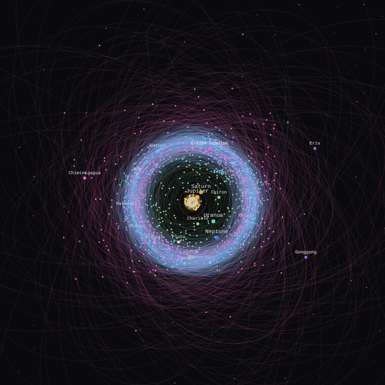

  

  
  
  

I build interactive maps of the universe, the small tools that keep them current, and a
philosophical framework that tries to explain who is looking. Most of it lives at
**[aperturecosmology.com](https://aperturecosmology.com/)**.

---

## 🌌 Aperture Cosmology

An independent research and creative project that approaches reality from three directions.
The portal asks you to **choose your path**:

- **Metaphysics** · a formal ontology of consciousness experiencing a static, higher-dimensional
  structure through localized apertures, developed across five connected essays.
- **Astrophysics** · interactive scientific references, including the two projects below.
- **Psychophysics** · experiential instruments: the *Aperture Dial* (binaural and isochronic
  synthesis with kaleidoscopic visuals) and a *Ganzflicker* simulator.

Standalone HTML pages · vanilla JS · Cloudflare Workers + D1

## 🪐 Solar System Explorer

An atlas of **2,012 objects** drawn on their real orbits: planets, dwarf planets, 537 moons,
near-Earth objects, the asteroid belt, Trojans, centaurs, the Kuiper belt, the scattered and
detached discs, comets and all three known interstellar visitors. Zoom from the inner planets out
to the detached disc, click any world to inspect its orbital elements, drop into a planet's moon
system, or switch to a sortable, searchable table of the whole database. Everything is drawn on a
plain 2D canvas with no libraries.

<table>
  <tr>
    <td width="50%"></td>
    <td width="50%"></td>
  </tr>
  <tr>
    <td align="center">Saturn's moons and the detail panel</td>
    <td align="center">Out to the Scattered Disc</td>
  </tr>
</table>

## 🔭 Laniakea Field Guide

A field guide to our home supercluster, built on my paper
**[A Hierarchical Framework for Organizing the Laniakea Basin](https://aperturecosmology.com/laniakea/downloads/Bianchini_2026_Laniakea_Framework.pdf)**
(Bianchini, 2026; 86 peer-reviewed references including the Cosmicflows program). It organizes
the local universe by cosmic-web topology rather than distance or brightness:
**4 superclusters · 27 structural regions · 128 galaxy groups**, across roughly 500 million
light-years, with an interactive chart and a dedicated page for every supercluster.

<table>
  <tr>
    <td width="50%"></td>
    <td width="50%"></td>
  </tr>
  <tr>
    <td align="center">The basin, galaxy groups by supercluster</td>
    <td align="center">Hydra, one of four supercluster lobes</td>
  </tr>
</table>

## 🛰️ Vera Rubin Analytics Bot

A daily GitHub Actions job that watches the Minor Planet Center's TNO and Centaur lists for new
possible dwarf planets, cross-checks sizes against JPL SBDB and Johnston's Archive, and opens an
alert when something might be 190 km in radius or more. Its findings feed the Solar System
Explorer. Most new finds now come from the Vera C. Rubin Observatory. This is the live watchlist:

<!-- watchlist:start -->
| Object | Status | Radius (km) | H | a (AU) | Found | By |
|---|---|--:|--:|--:|---|---|
| **2025 NE552** | 🟡 likely | ~302 | 4.33 | 53.5 | 2025-07-04 | Rubin Observatory |
| **2025 EA16** | 🟡 likely | ~273 | 4.55 | 40.6 | 2025-03-10 | DECam, Cerro Tololo |
| **2025 MZ348** | 🟡 likely | ~258 | 4.67 | 47.8 | 2025-06-30 | Rubin Observatory |
| **2025 MT387** | 🟡 likely | ~231 | 4.91 | 54.9 | 2025-06-21 | Rubin Observatory |
| **2025 MB349** | 🟡 likely | ~201 | 5.21 | 50.2 | 2025-06-21 | Rubin Observatory |

9 more on the watchlist

| Object | Status | Radius (km) | H | a (AU) | Found | By |
|---|---|--:|--:|--:|---|---|
| **2025 MD350** | ⚪ watched | ~183 | 5.41 | 61.1 | 2025-06-21 | Rubin Observatory |
| **2025 UP145** | ⚪ watched | ~180 | 5.45 | 56.0 | 2025-10-29 | Magellan-Baade Telescope |
| **2025 NY190** | ⚪ watched | ~180 | 5.45 | 47.7 | 2025-07-02 | Rubin Observatory |
| **2015 HT198** | ⚪ watched | ~174 | 5.53 | 43.5 | 2015-04-18 | DECam, Cerro Tololo |
| **2025 OF345** | ⚪ watched | ~166 | 5.62 | 43.0 | 2025-07-18 | Rubin Observatory |
| **2025 MJ352** | ⚪ watched | ~165 | 5.64 | 46.1 | 2025-06-21 | Rubin Observatory |
| **2025 NE189** | ⚪ watched | ~157 | 5.75 | 138.5 | 2025-07-02 | Rubin Observatory |
| **2025 NK190** | ⚪ watched | ~155 | 5.77 | 46.2 | 2025-07-02 | Rubin Observatory |
| **2025 NX193** | ⚪ watched | ~152 | 5.82 | 64.4 | 2025-07-01 | Rubin Observatory |

14 objects tracked, 11 of them discovered by Rubin Observatory. ~ marks a size estimated from brightness (H) at albedo 0.09. Last change 06 Oct 2026.
<!-- watchlist:end -->

## 🩺 OWCP AutoFill

A desktop tool that turns a batch of CMS-1500 (HCFA) PDFs into filled OWCP portal bill entries.
It parses each claim locally, lets you review it, then fills the form for a manual submit.
No patient data is transmitted, stored or logged.

## 📊 Languages and tools

  

  
  
  
  
  
  

Language card counts inline &lt;script&gt; and &lt;style&gt; as JavaScript and CSS, and skips vendored data. Refreshed weekly by <a href=".github/workflows/refresh-profile.yml">a workflow</a> in this repo.

